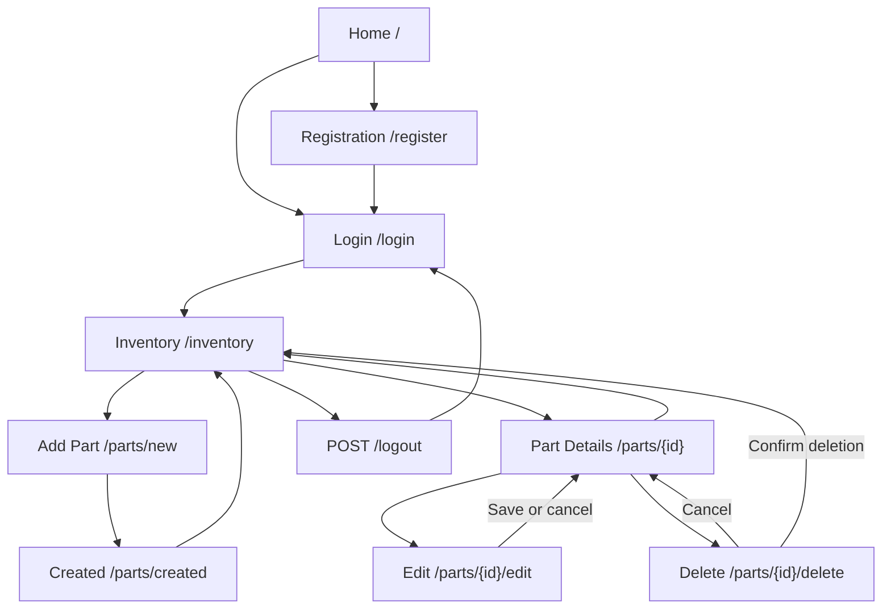
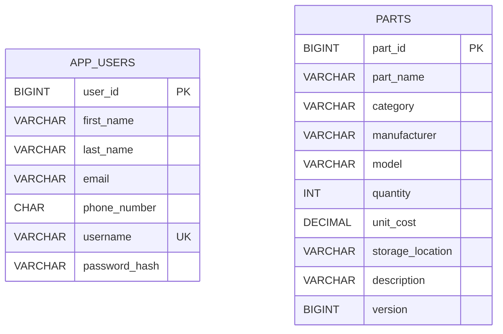
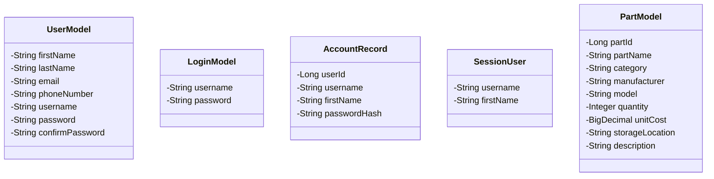
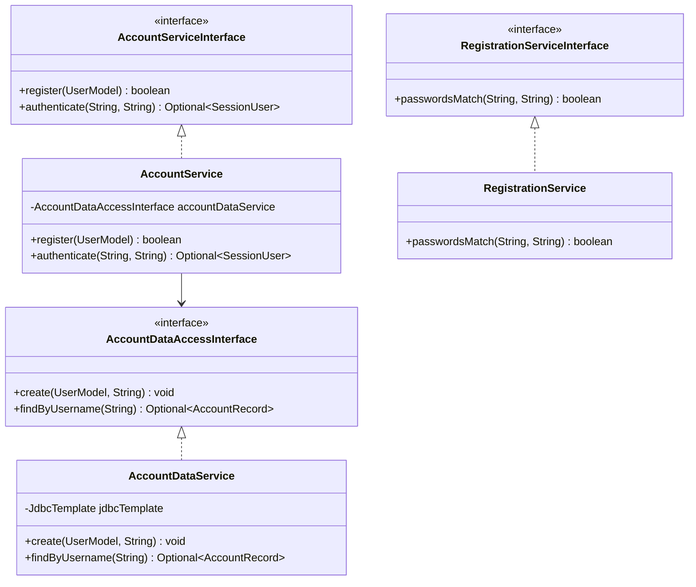
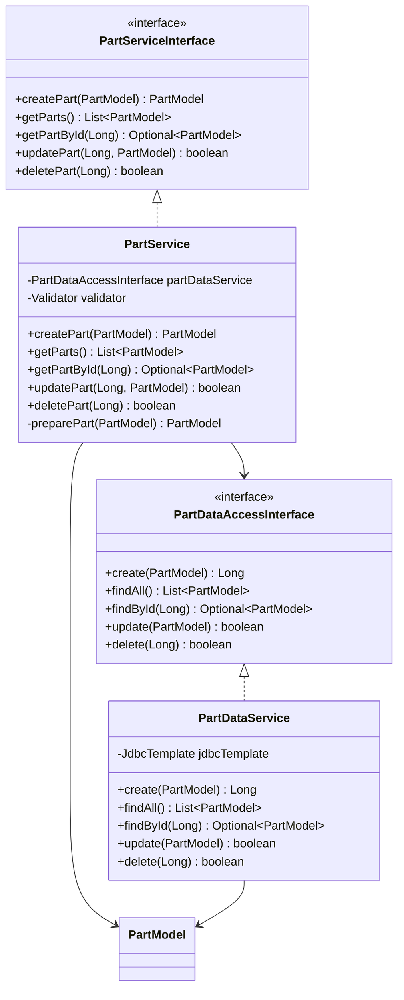
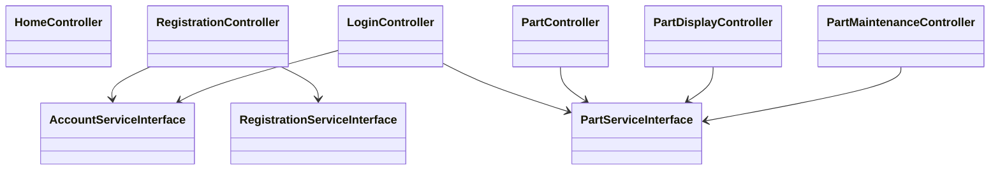

# Milestone 5: Design and Setup

[Overview](README.md) | [Planning](analysisPlanning.md) | [Test Plan](testPlan.md) | [Results](test.md)

## Installation and Configuration

The application uses Java 17, Spring Boot 2.7.18, Spring JDBC, Thymeleaf, Bootstrap, and MySQL 5.7.24.

### Database

Run the existing [DDL script](../milestone4/database/schema.sql) when setting up a new database. It creates it_parts_inventory with app_users and parts tables.

The script does not drop existing data or modify existing table definitions. No schema migration was needed for Milestone 5.

The application account requires SELECT, INSERT, UPDATE, and DELETE privileges on it_parts_inventory.

### Application Properties

```properties
spring.application.name=it-parts-inventory
spring.datasource.url=jdbc:mysql://127.0.0.1:3306/it_parts_inventory
spring.datasource.username=cst339_app
spring.datasource.password=${DB_PASSWORD}
spring.sql.init.mode=never
```

Supply DB_PASSWORD through the launch environment. Do not store the actual password in source control.

### Eclipse

1. Start MySQL.
2. Import the application as an existing Maven project.
3. Select Java 17 and update the Maven project.
4. Set DB_PASSWORD in the application run configuration.
5. Stop other applications using port 8080.
6. Run ItPartsInventoryApplication.
7. Open http://localhost:8080/login.

### Executable JAR

Run these commands on the development computer:

```powershell
Set-Location 'C:\git\cst339\milestones\code\it-parts-inventory'

$env:JAVA_HOME = 'C:\opt\jdk-17.0.20.1+1'
$env:Path = "$env:JAVA_HOME\bin;$env:Path"

$dbCredential = Get-Credential -UserName 'cst339_app' -Message 'Enter your MySQL database password'
$env:DB_PASSWORD = $dbCredential.GetNetworkCredential().Password

.\mvnw.cmd clean package
java -jar target\it-parts-inventory.jar
```

Adjust paths on another computer. Press Ctrl+C to stop the application.

## Sitemap



Missing records redirect to inventory with a message. Logged-out requests to inventory, details, edit, and delete redirect to login.

## User Interface

All pages use the shared Thymeleaf layout. These previews show the implemented Milestone 5 pages.

| Page | Description | Preview | Page | Description | Preview |
| --- | --- | --- | --- | --- | --- |
| Inventory | Lists saved components and links to details | [](screenshots/01-inventory-list.png) | Details | Displays the saved fields and maintenance actions | [](screenshots/04-part-updated.png) |
| Edit | Prefills fields and displays validation feedback | [](screenshots/03-edit-part-form.png) | Delete | Identifies the record and requests confirmation | [](screenshots/06-delete-confirmation.png) |

### Existing Page Wireframes

```mermaid
flowchart TB
    subgraph homePage["Home"]
        h1["Shared navigation"] --> h2["Introduction and account links"]
        h2 --> h3["Component information and shared footer"]
    end
    subgraph registerPage["Registration"]
        r1["Shared navigation and heading"] --> r2["Name, email, phone and username"]
        r2 --> r3["Password and confirmation"]
        r3 --> r4["Validation, Create Account, Cancel and footer"]
    end
    subgraph loginPage["Login"]
        l1["Shared navigation and heading"] --> l2["Username and password"]
        l2 --> l3["Messages, Log In, registration link and footer"]
    end
    subgraph createPage["Add Part"]
        c1["Shared navigation and heading"] --> c2["Component fields and validation"]
        c2 --> c3["Create Part, Cancel and footer"]
    end
    subgraph createdPage["Creation Confirmation"]
        s1["Shared navigation and success message"] --> s2["Generated ID and saved fields"]
        s2 --> s3["Add Another Part, Inventory and footer"]
    end
```



### Inventory and Details Wireframes

```mermaid
flowchart TB
    subgraph inventoryPage["Inventory"]
        i1["Shared navigation and greeting"] --> i2["Success or error message"]
        i2 --> i3["Inventory Overview and Add Part"]
        i3 --> i4["ID, Name, Category, Quantity, Cost, Location, View Details"]
        i4 --> i5["Empty state or retry message when appropriate"]
        i5 --> i6["Shared footer"]
    end
    subgraph detailsPage["Part Details"]
        d1["Shared navigation and heading"] --> d2["Success message"]
        d2 --> d3["Saved part fields"]
        d3 --> d4["Edit Part, Delete Part, Return to Inventory"]
        d4 --> d5["Shared footer"]
    end
```



### Edit and Delete Wireframes

```mermaid
flowchart TB
    subgraph editPage["Edit Part"]
        e1["Shared navigation and instructions"] --> e2["Validation or database message"]
        e2 --> e3["Name, Category, Manufacturer, Model"]
        e3 --> e4["Quantity, Cost, Location, Description"]
        e4 --> e5["Save Changes and Cancel"]
        e5 --> e6["Shared footer"]
    end
    subgraph deletePage["Delete Part"]
        x1["Shared navigation and heading"] --> x2["Permanent deletion warning"]
        x2 --> x3["ID, Name, Category, Quantity, Location"]
        x3 --> x4["Confirm Delete and Cancel"]
        x4 --> x5["Shared footer"]
    end
```



## Database Design

The inventory is shared. There is no ownership foreign key between users and parts.



The complete column definitions and constraints are in the [DDL script](../milestone4/database/schema.sql).

Part IDs are auto-generated. Unit cost uses DECIMAL(12,2). Java uses BigDecimal for unit cost and Integer for quantity.

The version column is incremented by updates but is not mapped in PartModel or compared in the WHERE clause. It does not currently prevent conflicting edits.

MySQL 5.7.24 ignores CHECK constraints. The application validates required fields, permitted categories, lengths, and numeric limits before saving.

## Object Model Class Diagram

Getters and setters are omitted for readability. AccountRecord and SessionUser expose read access to their values.



## Account and Registration Service Diagram



## Part Service Diagram



## Controller Dependencies



## Service API

These are internal Java service contracts. This milestone does not expose a public REST API.

| Service method | Input | Result |
| --- | --- | --- |
| AccountService.register | UserModel | Whether registration succeeded |
| AccountService.authenticate | Username and password | Optional SessionUser |
| RegistrationService.passwordsMatch | Password and confirmation | Whether values match |
| PartService.createPart | PartModel | Saved model with generated ID |
| PartService.getParts | None | List of stored parts |
| PartService.getPartById | Long ID | Optional matching part |
| PartService.updatePart | Long ID and PartModel | True if an existing row was updated |
| PartService.deletePart | Long ID | True if an existing row was deleted |

PartService validates and normalizes creation/update data. Null or nonpositive lookup IDs produce an empty result; invalid update/delete IDs return false.

Database failures propagate to controllers, which display generic messages. MVC validation returns the submitted form with field errors.

### MVC Routes

| Method | Route | Purpose |
| --- | --- | --- |
| GET | / | Home |
| GET, POST | /register | Registration form and submission |
| GET, POST | /login | Login form and authentication |
| POST | /logout | End session |
| GET | /inventory | List saved parts |
| GET | /parts/new | Creation form |
| POST | /parts | Create a part |
| GET | /parts/created | Creation confirmation |
| GET | /parts/{id} | Part details |
| GET | /parts/{id}/edit | Prefilled edit form |
| POST | /parts/{id}/edit | Validate and update |
| GET | /parts/{id}/delete | Delete confirmation |
| POST | /parts/{id}/delete | Delete the selected record |

## Update and Delete Behavior

Updates use parameterized SQL and the identifier supplied by the route. The form binder permits only editable fields.

The update statement increments version so an unchanged submission still produces a row update. A zero-row result is treated as a missing record.

Delete confirmation uses GET only to display information. Deletion occurs through POST and succeeds only when one matching row is deleted.

Create, update, and delete DAO methods are transactional. Successful changes redirect to a GET page.

## Security Boundary

Session checks currently protect inventory retrieval, details, editing, and deletion. They are not a replacement for Spring Security or CSRF protection. The earlier creation routes require consistent protection in the next security milestone.