# Milestone 5: Testing and Screenshots

[Overview](README.md) | [Test Plan](testPlan.md) | [Design](design.md)

## Execution Summary

Testing was completed on October 11, 2026. The tester confirmed that the cancellation, missing-record, logged-out access, and restart checks passed.

The RAM record was updated from quantity 3 to 5. The disposable record, Test Delete Part with ID 3, was deleted. RAM and SSD remained.

## Screenshot Evidence

Click a thumbnail to open the full image.

| Test | Observed Result | Screenshot |
| --- | --- | --- |
| Inventory display | Two stored parts appear in the table | [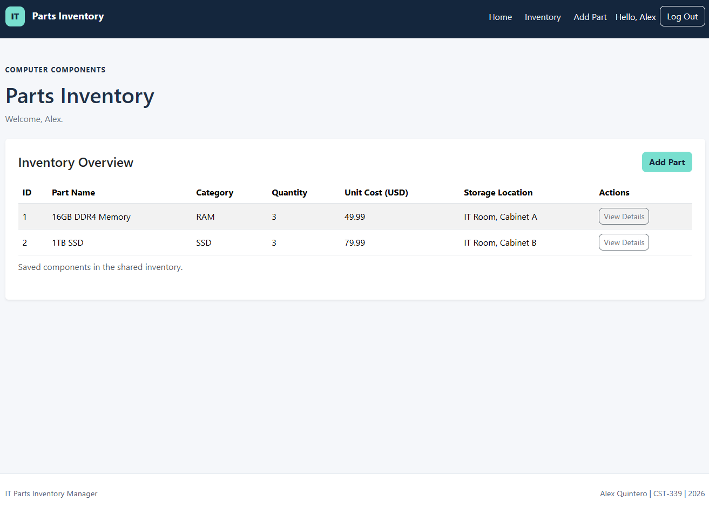](screenshots/01-inventory-list.png) |
| Part details | RAM fields are displayed | [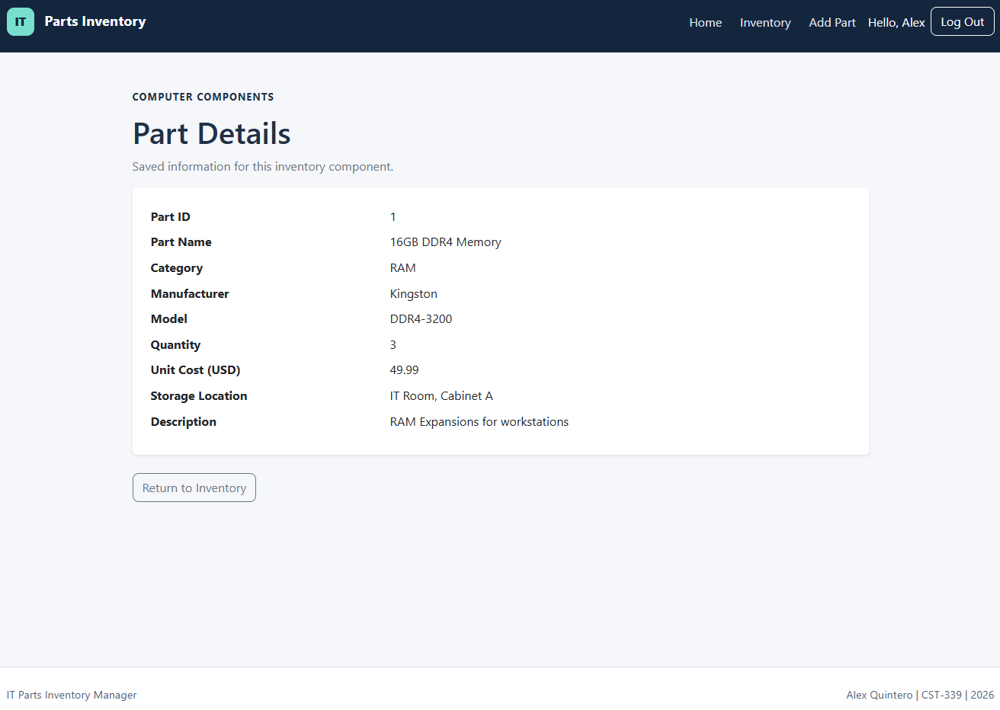](screenshots/02-part-details.png) |
| Prefilled editing | Existing values populate the edit form | [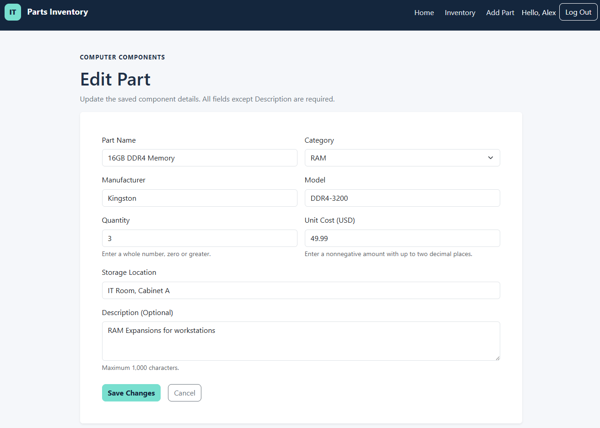](screenshots/03-edit-part-form.png) |
| Successful update | Quantity is 5 and a success message appears | [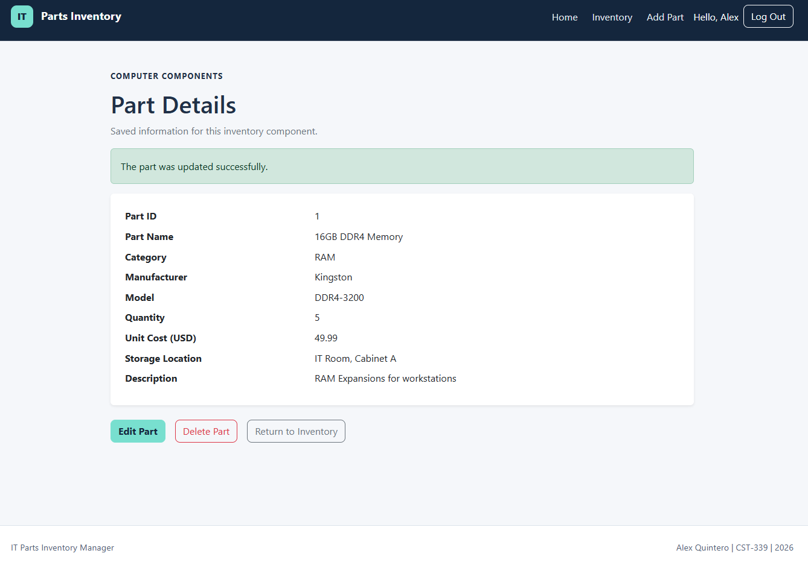](screenshots/04-part-updated.png) |
| Invalid editing | Negative quantity and cost show field errors | [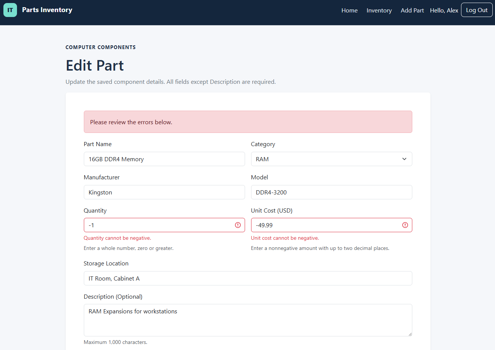](screenshots/05-invalid-edit.png) |
| Delete confirmation | The page identifies test record ID 3 | [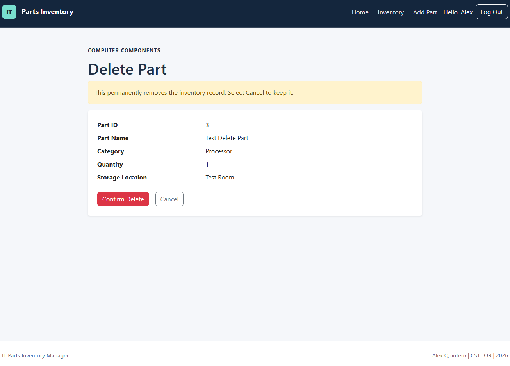](screenshots/06-delete-confirmation.png) |
| Successful deletion | Success message appears and RAM/SSD remain | [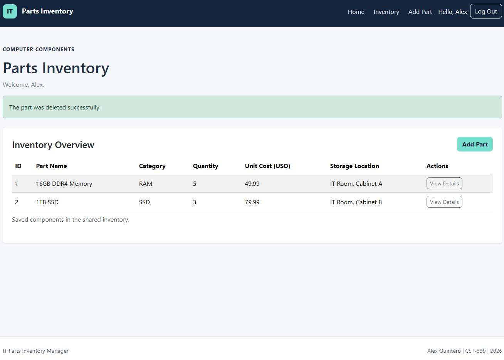](screenshots/07-part-deleted.png) |
| Missing record | Inventory displays the missing-part message | [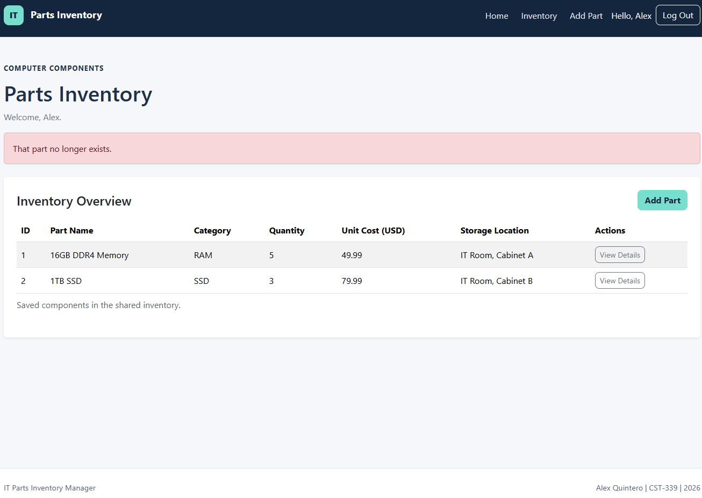](screenshots/08-part-not-found.png) |
| Login required | Login page is shown during logged-out access testing | [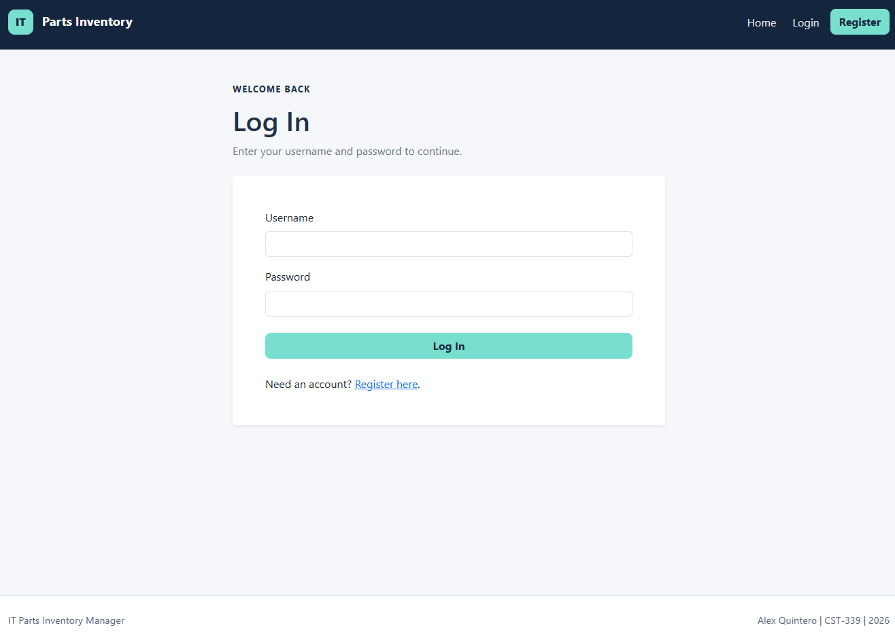](screenshots/09-login-required.png) |
| Restart persistence | RAM quantity remains 5 and SSD remains | [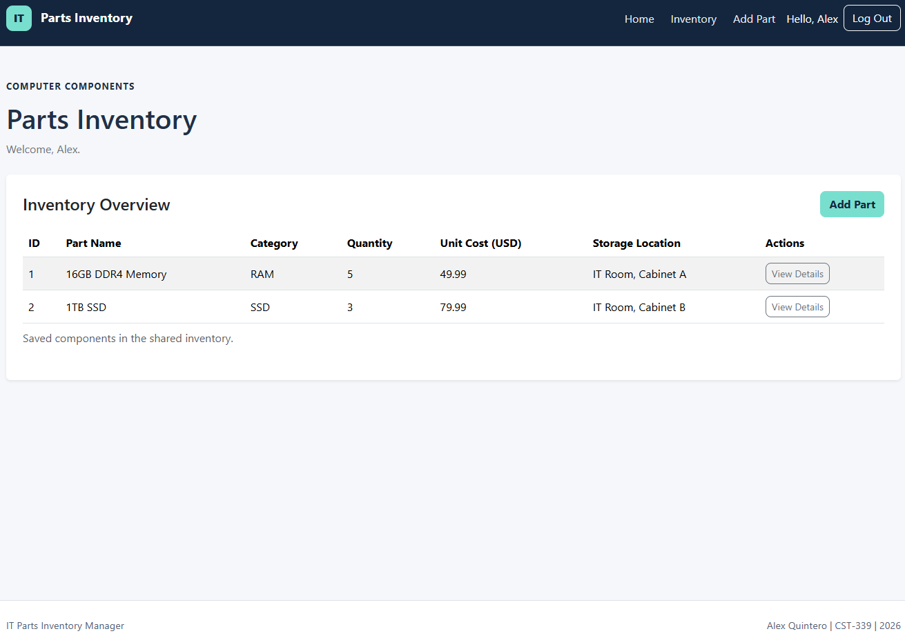](screenshots/10-inventory-after-restart.png) |
| Maven build | BUILD SUCCESS with one test and no failures or errors | [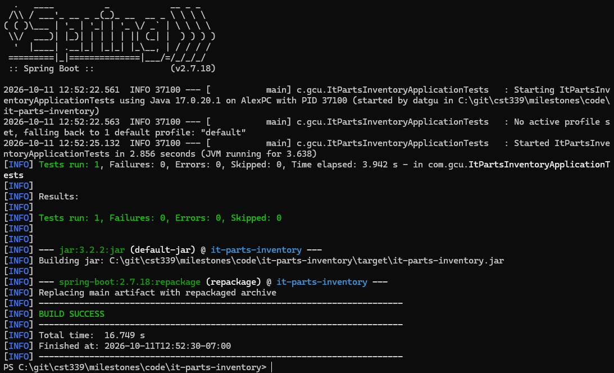](screenshots/11-maven-build-success.png) |
| JAR startup | Tomcat and the application start successfully | [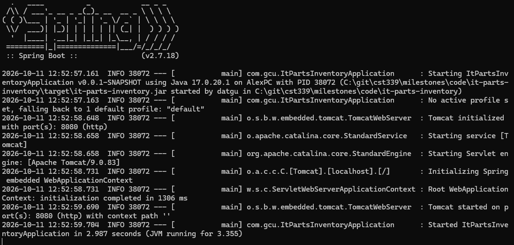](screenshots/12-executable-jar-startup.png) |
| JAR inventory | The packaged application displays saved parts | [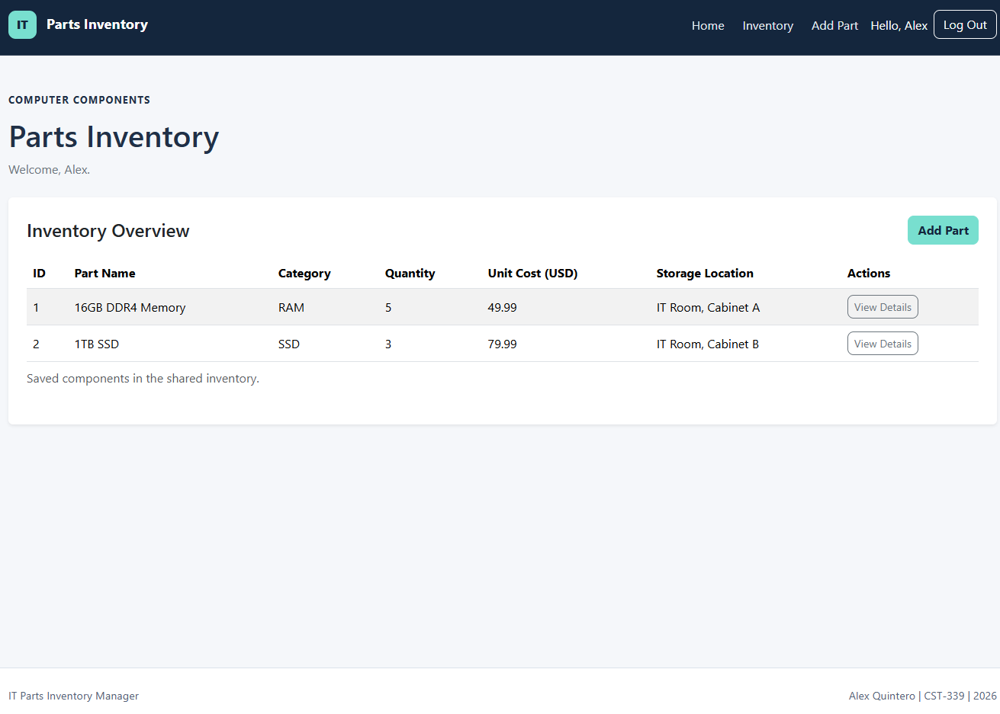](screenshots/13-executable-jar-inventory.png) |

## Additional Confirmed Checks

The tester confirmed:

- Cancel Edit left RAM quantity at 5.
- Cancel Delete kept the selected record.
- Missing-part details, edit, and delete URLs returned the missing-record message.
- Logged-out inventory, details, edit, and delete URLs redirected to login.
- Restarting preserved the update and deletion.

These confirmations supplement screenshots that cannot show an entire interaction.

## Automated Build Result

The Maven build reported:

- Tests run: 1.
- Failures: 0.
- Errors: 0.
- Skipped: 0.
- Result: BUILD SUCCESS.

This was the application-context test, not a complete automated CRUD suite.

## Demonstration

[Watch the Milestone 5 technical and functional demonstration](https://youtu.be/6aJvDrHsrDI)

## Conclusion

The executed cases demonstrate database-backed inventory display, details, editing, deletion, cancellation, validation, missing-record handling, and persistence across restarts.

The packaged application also started successfully and displayed the stored inventory. Untested scenarios and known limitations are recorded in the test plan and planning documentation.