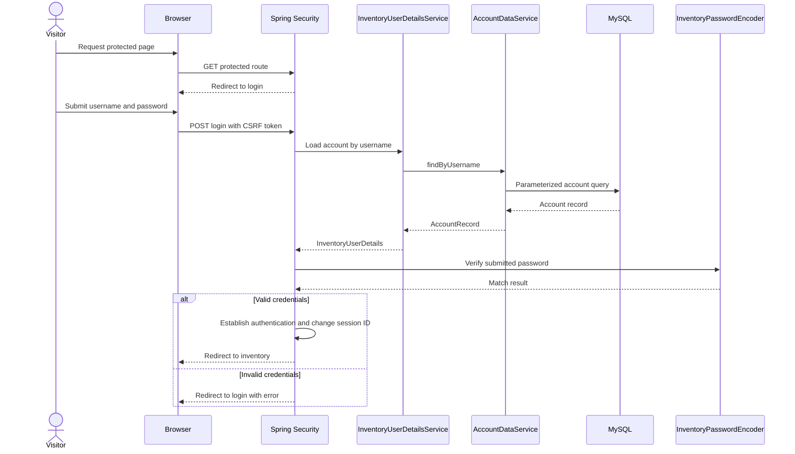
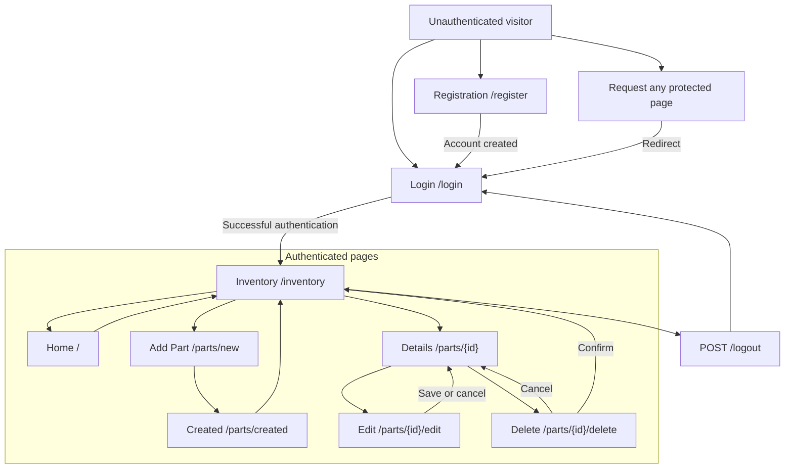
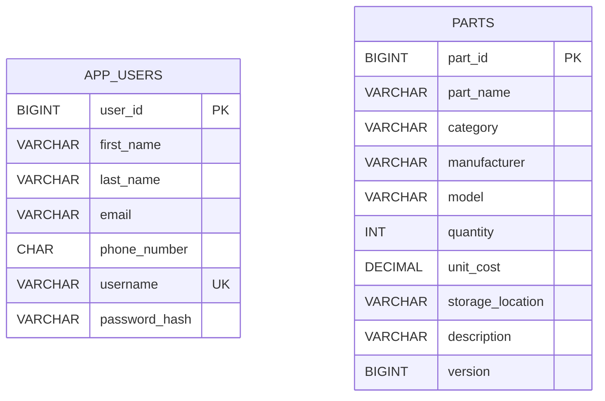
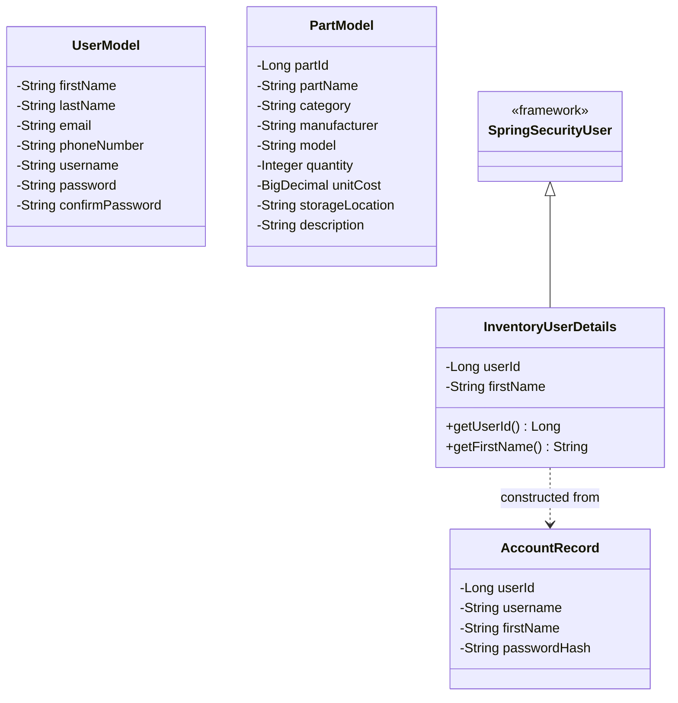
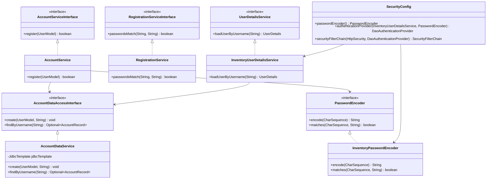
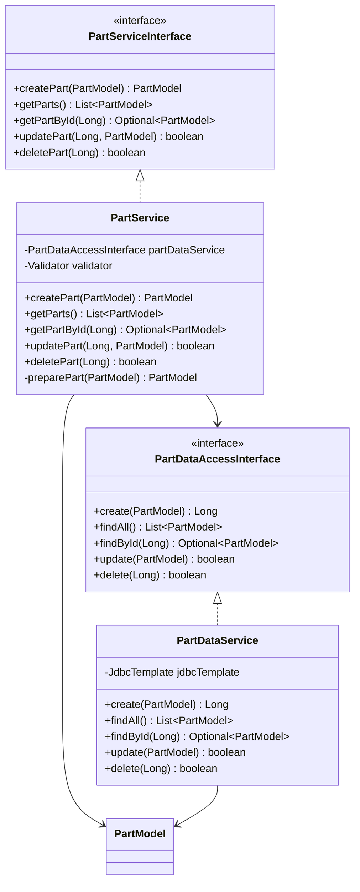
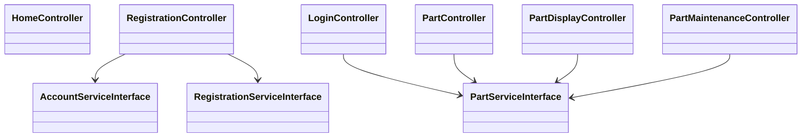

# Milestone 6: Design and Setup

[Overview](README.md) | [Planning](analysisPlanning.md) | [Test Plan](testPlan.md) | [Results](test.md)

## General Technical Approach

The application uses Spring MVC and Thymeleaf for presentation, Spring-managed business services for account and inventory operations, and Spring JDBC for MySQL persistence.

Spring Security protects requests before they reach controllers. Database-backed form authentication replaces the previous manual login processing and currentUser session attribute.

The inventory remains shared across authenticated accounts.

## Technology

- Java 17
- Spring Boot 2.7.18
- Spring Security
- Thymeleaf and Thymeleaf Spring Security extras
- Thymeleaf Layout Dialect
- Bootstrap 5.3.3
- Spring JDBC
- MySQL 5.7.24
- Maven

## Installation and Configuration

### Database

Use the existing [DDL script](../milestone4/database/schema.sql) when setting up a new database.

It creates the it_parts_inventory database with app_users and parts tables. No schema migration was required for Milestone 6.

The application database account requires SELECT, INSERT, UPDATE, and DELETE privileges on the application database.

Existing passwords remain compatible with the new encoder. Do not replace existing password hashes with plaintext values.

### Application Properties

```properties
spring.application.name=it-parts-inventory
spring.datasource.url=jdbc:mysql://127.0.0.1:3306/it_parts_inventory
spring.datasource.username=cst339_app
spring.datasource.password=${DB_PASSWORD}
spring.sql.init.mode=never
```

Supply DB_PASSWORD through the environment used to launch the application. The MySQL account password is separate from the credentials entered on the application login page.

### Eclipse

1. Start MySQL in MAMP.
2. Import the application as an existing Maven project.
3. Select Java 17 and update the Maven project.
4. Set DB_PASSWORD in the ItPartsInventoryApplication run configuration.
5. Stop other applications using port 8080.
6. Run ItPartsInventoryApplication.
7. Wait for the application-started message.
8. Open http://localhost:8080/.
9. Keep the application running during browser testing.

An unauthenticated request to the home page redirects to login. Registration remains available without authentication.

### Executable JAR

Stop the Eclipse application before starting the JAR. Keep MySQL running.

Run the following in PowerShell on the development computer:

```powershell
Set-Location 'C:\git\cst339\milestones\code\it-parts-inventory'

$env:JAVA_HOME = 'C:\opt\jdk-17.0.20.1+1'
$env:Path = "$env:JAVA_HOME\bin;$env:Path"

$dbSecret = Read-Host 'Enter your MySQL database password' -AsSecureString
$env:DB_PASSWORD = [System.Net.NetworkCredential]::new('', $dbSecret).Password

.\mvnw.cmd clean package
java -jar target\it-parts-inventory.jar
```

Adjust paths for another computer. Wait for the application-started message, then open the application in a browser. Press Ctrl+C to stop it.

Environment variables configured in Eclipse do not automatically become available in a separate PowerShell session.

## Key Technical Decisions

| Decision | Purpose |
| --- | --- |
| Database-backed form authentication | Reuses existing MySQL accounts |
| Compatible PBKDF2 PasswordEncoder | Preserves existing credentials and supports new registrations |
| Central SecurityFilterChain | Applies authentication requirements before controller execution |
| InventoryUserDetails principal | Supplies the account identifier and display name |
| Shared PasswordEncoder bean | Uses the same credential format for registration and authentication |
| POST forms with CSRF protection | Protects state-changing browser requests |
| Session ID change after authentication | Provides session fixation protection |
| Constructor injection | Makes component dependencies explicit |
| Parameterized JDBC queries | Separates SQL statements from submitted values |

## Authentication Flow



Authentication always redirects to inventory after a successful login. The application does not restore the originally requested page.

## Sitemap



Missing records redirect to inventory with an explanatory message. CSS, JavaScript, images, and other configured supporting resources remain public.

## User Interface

Pages retain the shared navigation, footer, responsive Bootstrap layout, and existing inventory styling.

Click a preview to open its full screenshot.

| Page | Description | Preview | Page | Description | Preview |
| --- | --- | --- | --- | --- | --- |
| Login | Public form with authentication messages | [](screenshots/03-invalid-login.png) | Registration | Public account creation form | [](screenshots/02-public-registration.png) |
| Inventory | Shared parts and authenticated greeting | [](screenshots/04-authenticated-inventory.png) | Details | Saved fields and maintenance actions | [](screenshots/08-part-details.png) |
| Edit | Prefilled fields and validation feedback | [](screenshots/09-edit-form.png) | Delete | Explicit confirmation before deletion | [](screenshots/13-delete-confirmation.png) |
| Created | Saved part and generated identifier | [](screenshots/12-part-created.png) | Logout | Confirmation and anonymous navigation | [](screenshots/05-logout.png) |

### Account and Home Wireframes

```mermaid
flowchart TB
    subgraph loginPage["Login"]
        l1["Anonymous navigation"] --> l2["Heading and status messages"]
        l2 --> l3["Username and password"]
        l3 --> l4["Log In and registration link"]
        l4 --> l5["Shared footer"]
    end
    subgraph registrationPage["Registration"]
        r1["Anonymous navigation"] --> r2["Name, email, phone and username"]
        r2 --> r3["Password and confirmation"]
        r3 --> r4["Validation, Create Account and Cancel"]
        r4 --> r5["Shared footer"]
    end
    subgraph homePage["Protected Home"]
        h1["Authenticated navigation and greeting"] --> h2["Application introduction"]
        h2 --> h3["Existing links and component information"]
        h3 --> h4["Shared footer"]
    end
```



### Inventory Wireframes

```mermaid
flowchart TB
    subgraph inventoryPage["Inventory"]
        i1["Navigation and greeting"] --> i2["Success or error message"]
        i2 --> i3["Inventory Overview and Add Part"]
        i3 --> i4["Parts table with View Details"]
        i4 --> i5["Empty state or retry when appropriate"]
        i5 --> i6["Footer"]
    end
    subgraph detailPage["Details"]
        d1["Navigation and heading"] --> d2["Saved part fields"]
        d2 --> d3["Edit, Delete and Return to Inventory"]
        d3 --> d4["Footer"]
    end
    subgraph formPage["Add or Edit Part"]
        f1["Navigation and instructions"] --> f2["Name, category, manufacturer and model"]
        f2 --> f3["Quantity, cost, location and description"]
        f3 --> f4["Validation feedback"]
        f4 --> f5["Save and Cancel"]
        f5 --> f6["Footer"]
    end
    subgraph createdPage["Creation Confirmation"]
        c1["Navigation and success message"] --> c2["Generated ID and saved values"]
        c2 --> c3["Add Another Part and Inventory"]
        c3 --> c4["Footer"]
    end
    subgraph deletePage["Delete Confirmation"]
        x1["Navigation and warning"] --> x2["Selected record summary"]
        x2 --> x3["Confirm Delete and Cancel"]
        x3 --> x4["Footer"]
    end
```



## Database Design

Users and parts are independent tables because inventory is shared. There is no ownership foreign key.



The [DDL script](../milestone4/database/schema.sql) contains complete column definitions and constraints.

Part identifiers are generated by the database. Unit cost uses DECIMAL(12,2), represented by BigDecimal in Java.

The version column is incremented by updates but is not compared against a previously read version. It does not provide optimistic locking.

MySQL 5.7.24 does not enforce CHECK constraints. Java validation checks submitted values before persistence.

## Object Model Class Diagram

Accessors are omitted except where they explain security integration.



LoginModel and SessionUser were removed. Spring Security processes submitted login fields and maintains the authenticated principal.

## Account and Security Service Diagram



The configured DaoAuthenticationProvider coordinates account retrieval and password verification.

## Part Service Diagram



## Controller Dependencies



LoginController displays the login page and inventory. It no longer processes passwords, creates authentication sessions, or handles logout.

## Service API

These are internal Java contracts. REST endpoints are scheduled for Milestone 7.

| Service method | Input | Result |
| --- | --- | --- |
| AccountService.register | Validated UserModel | True when created; false for duplicate username |
| RegistrationService.passwordsMatch | Password and confirmation | Whether values match |
| InventoryUserDetailsService.loadUserByUsername | Username | UserDetails or UsernameNotFoundException |
| InventoryPasswordEncoder.encode | Raw password | Encoded PBKDF2 credentials |
| InventoryPasswordEncoder.matches | Raw password and stored credentials | Whether the password matches |
| PartService.createPart | PartModel | Saved model with generated ID |
| PartService.getParts | None | List of stored parts |
| PartService.getPartById | Long ID | Optional matching part |
| PartService.updatePart | Long ID and PartModel | Whether an existing record was updated |
| PartService.deletePart | Long ID | Whether an existing record was deleted |

PartService validates and normalizes creation and update data. Missing records produce empty lookup results or false update/delete results.

Database failures propagate to the coordinating layer. Controllers display generic inventory messages; authentication failures return to the login error page.

### Persistence Contracts

| DAO method | Result |
| --- | --- |
| AccountDataService.create | Inserts an account with encoded credentials |
| AccountDataService.findByUsername | Optional account record |
| PartDataService.create | Generated part ID |
| PartDataService.findAll | Stored parts |
| PartDataService.findById | Optional matching part |
| PartDataService.update | Whether a matching row was updated |
| PartDataService.delete | Whether a matching row was deleted |

## Application Routes

| Method | Route | Access and purpose |
| --- | --- | --- |
| GET | / | Authenticated home page |
| GET, POST | /register | Public registration form and submission |
| GET | /login | Public login form |
| POST | /login | Spring Security authentication processing |
| POST | /logout | Spring Security logout processing |
| GET | /inventory | Authenticated inventory list |
| GET | /parts/new | Authenticated creation form |
| POST | /parts | Authenticated part creation |
| GET | /parts/created | Authenticated creation confirmation |
| GET | /parts/{id} | Authenticated part details |
| GET, POST | /parts/{id}/edit | Authenticated editing |
| GET | /parts/{id}/delete | Authenticated deletion confirmation |
| POST | /parts/{id}/delete | Authenticated deletion |

POST forms require a valid CSRF token, including public registration and login forms. Thymeleaf's Spring integration includes the token in the POST forms using th:action.

Internal ERROR dispatches are permitted so error rendering does not create an authentication redirect loop.

## Update and Delete Behavior

Form binding permits only editable part fields. Update operations use the route identifier to select the target record.

Create, update, and delete operations use parameterized SQL. Successful changes redirect to a GET page.

The delete confirmation page does not modify data. Deletion occurs only when its POST form is submitted.

Missing records redirect to inventory with “That part no longer exists.”

## Known Issues and Risks

Concurrent edits use last-save-wins behavior. All authenticated accounts share the same access level, and the application has no ownership restrictions.

CSRF protection is configured, but dedicated invalid-token tests were not executed. The automated build contains one application-context test rather than a full security regression suite.

Additional limitations and deployment considerations are documented in [Analysis and Planning](analysisPlanning.md).